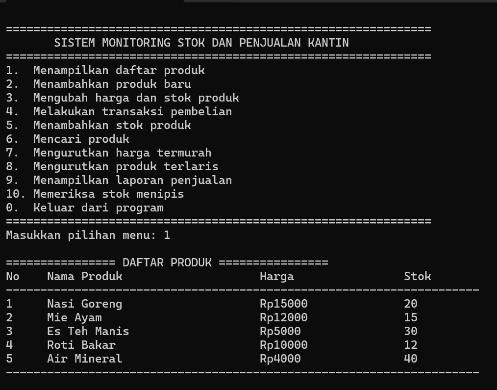

# SISTEM MONITORING STOK DAN PENJUALAN KANTIN KAMPUS

## Identitas Mahasiswa
- **Nama:** Nasywaa Naadiyatulummah
- **NIM:** C2583207031
- **Kelas:** PTI3B
- **Mata Kuliah:** Algoritma dan Pemrograman Lanjutan
- **Dosen Pengampu:** Taofik Muhammad, M.Kom

## Deskripsi Proyek
Aplikasi berbasis bahasa C untuk mengelola stok dan penjualan produk kantin kampus menggunakan array.

## Fitur Program
1. Menampilkan daftar produk.
2. Menambahkan produk baru.
3. Mengubah harga dan stok produk.
4. Melakukan transaksi penjualan.
5. Menambahkan stok produk.
6. Mencari produk berdasarkan nama.
7. Mengurutkan produk berdasarkan harga dan jumlah terjual.
8. Menampilkan laporan penjualan.
9. Mengecek stok produk yang kurang dari 5.
10. Menampilkan produk terlaris.

## Penerapan Array
Program menggunakan array sebagai struktur data utama:
- **Array 1 dimensi:** Menyimpan harga, stok, dan jumlah produk terjual.
- **Array karakter 2 dimensi:** Menyimpan nama produk.

Kapasitas maksimal penyimpanan adalah 50 produk dengan minimal 5 produk sebagai data awal.

## Cara Menjalankan Program

### 1. Persiapan
Pastikan GCC sudah terinstal pada komputer.

### 2. Kompilasi Program
Buka terminal pada folder penyimpanan file program, kemudian ketik:

```bash
gcc main.c -o kantin
```

### 3. Menjalankan Program

Untuk Windows:
```bash
kantin.exe
```

Untuk Linux:
```bash
./kantin
```

## Dokumentasi Pengujian

###  Tampilan 


### 1. Tampilan 1


### 2. Tampilan 2


### 3. Tampilan 3


### 4. Tampilan 4


### 5. Tampilan 5


### 6. Tampilan 6


### 7. Tampilan 7


### 8. Tampilan 8


### 9. Tampilan 9


### 10. Tampilan 10


